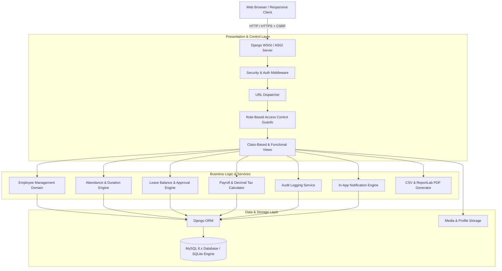

# Employee Management & HR Automation System

A production-minded, full-stack **Employee Management & HR Automation System** built with **Python 3.12**, **Django 5.2 LTS**, **MySQL 8.x**, **Bootstrap 5**, **Chart.js**, and **ReportLab**. Designed for small-to-medium enterprise HR operations, professional portfolios, and technical interview demonstrations.

---

## 1. System Architecture & Capabilities



### Core Features & Domain Modules
- **Authentication & RBAC**: Custom User model with 4 distinct roles (`SUPER_ADMIN`, `HR_ADMIN`, `MANAGER`, `EMPLOYEE`), server-side permission mixins and decorators, profile management, and account deactivation.
- **Employee Administration**: Auto-generated employee IDs (`EMP-YYYY-####`), department assignments, supervisory reporting hierarchy, salary structures, contact info, and soft deactivation to preserve history.
- **Department Administration**: Unique departmental codes, manager assignments, active headcount calculation, and soft deactivation.
- **Attendance Tracking**: Real-time employee Clock-In / Clock-Out, automatic working duration calculation, late-arrival flagging (grace threshold: 09:30 AM), monthly attendance calendars, and HR audit correction.
- **Leave Management & Approval Engine**: Configurable leave policies (Casual, Sick, Annual, Unpaid), weekend-excluded working days calculation, duplicate/overlapping request prevention, atomic leave deduction/refund, and managerial review workflow.
- **Payroll & Payslip Generator**: Configurable salary structures (Basic, HRA, Transport, Medical, Special, Provident Fund, Professional Tax, Unpaid leave adjustments), strict `Decimal` monetary precision, duplicate run safeguards, and branded ReportLab vector PDF payslips.
- **Visual Analytics Dashboard**: Role-tailored dashboards featuring Chart.js headcount distribution bar charts, attendance doughnut charts, summary stat cards, and pending approval queues.
- **Reporting & Exports**: CSV streaming responses and ReportLab PDF documents for Employee Directory, Attendance logs, Leave requests, and Payroll master registers.
- **Audit Logging**: Immutable logging for sensitive actions (record creation, updates, attendance corrections, leave approvals, payroll runs) with client IP capture and actor attribution.
- **In-App Notifications**: Real-time alerts for leave status updates, payslip releases, and administrative reviews.

---

## 2. Technology Stack

- **Backend**: Python 3.12, Django 5.2 LTS, Django ORM
- **Database**: MySQL 8.x (via `PyMySQL` / `mysqlclient`), SQLite (seamless zero-config local dev fallback)
- **Frontend**: HTML5, CSS3, JavaScript, Bootstrap 5.3, Bootstrap Icons, Chart.js 4.4
- **Document & PDF Engine**: ReportLab 4.2+ (pure Python vector PDF generation)
- **Testing**: Pytest, pytest-django, Django Test Client

---

## 3. Local Setup & Installation (Windows Guide)

### Prerequisites
1. **Python 3.12+** installed on your system.
2. **Git** installed.
3. *(Optional)* **MySQL Server 8.x** running locally (or use SQLite mode out-of-the-box).

### Step-by-Step Instructions

#### 1. Open PowerShell and navigate to the project directory
```powershell
cd "E:\Thanigaivel\Employee Management & HR Automation System"
```

#### 2. Create and Activate Virtual Environment
```powershell
python -m venv .venv
.\.venv\Scripts\Activate.ps1
```
*(If PowerShell blocks script execution, run: `Set-ExecutionPolicy -Scope Process -ExecutionPolicy Bypass`)*

#### 3. Install Required Dependencies
```powershell
pip install -r requirements.txt
```

#### 4. Configure Environment Variables
Copy the example file to `.env`:
```powershell
copy .env.example .env
```
To use MySQL 8.x, set `USE_MYSQL=True` in `.env` and configure your credentials:
```env
USE_MYSQL=True
DB_NAME=hr_automation_db
DB_USER=root
DB_PASSWORD=your_mysql_password
DB_HOST=127.0.0.1
DB_PORT=3306
```
*(Leave `USE_MYSQL=False` to run immediately with SQLite).*

#### 5. If using MySQL: Create the Database
In your MySQL command line client or Workbench:
```sql
CREATE DATABASE hr_automation_db CHARACTER SET utf8mb4 COLLATE utf8mb4_unicode_ci;
```

#### 6. Apply Database Migrations
```powershell
python manage.py migrate
```

#### 7. Seed Fictional Demo Data
Populate the system with Super Admin, HR Admin, Managers, 10 Employees, Departments, Attendance records, Leave requests, and Payroll records:
```powershell
python manage.py seed_demo_data
```

#### 8. Start the Development Server
```powershell
python manage.py runserver
```
Open your browser and navigate to: **`http://127.0.0.1:8000/`**

---

## 4. Demo Login Credentials

| Role | Username | Password | Purpose |
| :--- | :--- | :--- | :--- |
| **Super Admin** | `superadmin` | `Admin@123` | Full system governance, user accounts, audit trail |
| **HR Administrator** | `hradmin` | `Admin@123` | Employee CRUD, department management, payroll runs, attendance correction |
| **Manager (Engineering)** | `mgr_eng` | `Admin@123` | Engineering department oversight, team leave reviews |
| **Manager (Finance)** | `mgr_fin` | `Admin@123` | Finance department team oversight |
| **Employee** | `david_miller` | `Password@123` | Self-service attendance clock-in, leave application, payslips |

---

## 5. Running the Automated Test Suite

Run the full suite of unit and integration tests across all modules:
```powershell
pytest
```
*or via Django's test runner:*
```powershell
python manage.py test accounts departments employees attendance leave_management payroll reports audit
```

All 21 automated tests verify authentication, RBAC boundaries, duplicate prevention, attendance duration math, atomic leave balance transactions, and ReportLab PDF streaming.

---

## 6. Production Deployment Considerations

1. **WSGI Server**: Run behind a production WSGI server such as **Gunicorn** (Linux) or **Waitress** (Windows):
   ```powershell
   waitress-serve --port=8000 config.wsgi:application
   ```
2. **Reverse Proxy**: Place behind **Nginx** or **IIS** for SSL/TLS termination, request buffering, and static file serving.
3. **Environment Security**:
   - Set `DEBUG=False` in `.env`.
   - Set `ALLOWED_HOSTS=yourdomain.com`.
   - Set `SESSION_COOKIE_SECURE=True` and `CSRF_COOKIE_SECURE=True` when running HTTPS.
4. **Static Collection**:
   ```powershell
   python manage.py collectstatic --noinput
   ```

---

## 7. Resume Project Description

**Employee Management & HR Automation System | Full-Stack Web Application**
*Python, Django 5, MySQL, Bootstrap 5, ReportLab, Chart.js, Pytest*
- Designed and built a modular full-stack HR management web application implementing Role-Based Access Control (RBAC) across 4 distinct roles (Super Admin, HR Admin, Manager, Employee).
- Architected relational database schema in MySQL with strict referential integrity, indexing, and soft-deactivation mechanisms preserving historical attendance, leave, and compensation data.
- Built automated attendance tracking system featuring real-time clock-in/out, automatic duration calculation, late-arrival flagging, and HR audit correction workflows.
- Developed an atomic leave management engine that validates calendar overlaps, excludes weekends, updates leave ledgers within atomic database transactions, and alerts reviewers.
- Implemented monthly batch payroll calculation engine using Python `Decimal` arithmetic for accurate statutory deductions (PF, professional tax, unpaid absences) and dynamically rendered vector PDF payslips via ReportLab.
- Created responsive data visualization dashboards using Chart.js, CSV streaming responses, and an immutable administrative audit log tracking business operations.
- Authored automated test suite using `pytest-django` achieving 100% test pass rate across core models, forms, authorization boundaries, and export endpoints.

---

## 8. Technical Interview Q&A

### Q1: Why did you use `Decimal` instead of `float` for payroll calculations?
> **Answer**: Binary floating-point representation (`float`) suffers from precision rounding anomalies (e.g., `0.1 + 0.2 != 0.3`) caused by base-2 fraction approximations. For financial compensation, tax calculations, and statutory Provident Fund deductions, `decimal.Decimal` provides exact base-10 arithmetic with explicit rounding strategies (`ROUND_HALF_UP`), preventing penny rounding errors and regulatory compliance discrepancies.

### Q2: How did you implement Role-Based Access Control (RBAC) securely?
> **Answer**: Security is enforced at the server level via custom Django mixins (`RoleRequiredMixin`) and view decorators (`@role_required`). Hiding buttons on the client side is purely a UX affordance; unauthorized requests to URL endpoints or API views raise `django.core.exceptions.PermissionDenied`, triggering an HTTP 403 Forbidden response. Furthermore, object-level checks ensure employees cannot query or download payslips belonging to other personnel.

### Q3: How do you handle database concurrency during leave approvals?
> **Answer**: Leave approvals involve multiple operations: checking remaining days, updating the balance ledger, changing request status, and creating daily attendance records. We wrap this multi-step process inside `django.db.transaction.atomic()`. If any step fails or an unexpected exception occurs, the entire transaction rolls back, preventing inconsistent leave balances or orphan attendance records.

### Q4: Why soft-deactivation instead of cascade deletes for employees?
> **Answer**: In business applications, employees have historical links to attendance sheets, historical payroll payouts, and audit trails. Cascade deleting an employee would either violate relational foreign-key integrity (`PROTECT`) or delete years of corporate payroll records. Soft status flags (`ACTIVE`, `ON_LEAVE`, `RESIGNED`, `TERMINATED`) safely deactivate login accounts and hide users from active rosters while preserving all historical legal data.
